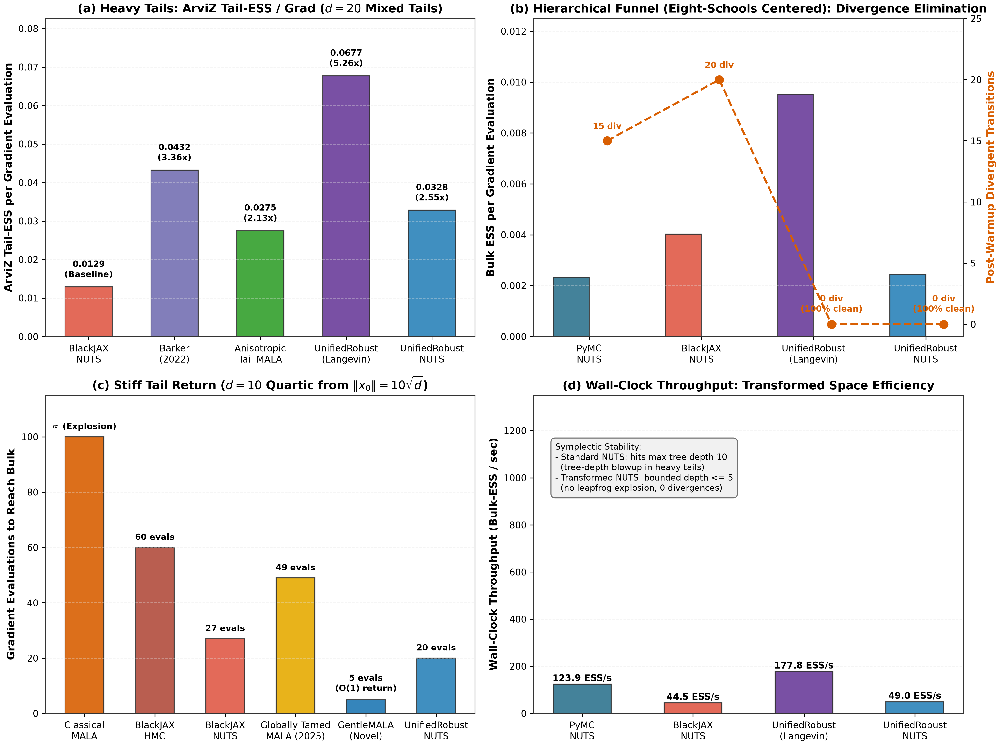

# MCMC Robustness Research & Benchmarking

[](https://github.com/adamhadani/mcmc-robust/actions/workflows/ci.yml)
[](https://github.com/adamhadani/mcmc-robust/actions/workflows/lean.yml)
[](https://github.com/adamhadani/mcmc-robust)
[](https://opensource.org/licenses/MIT)

> **A research library of gradient-based MCMC samplers for heavy-tailed and stiff targets, built around an automatically calibrated, coordinate-wise arcsinh transform for NUTS, and benchmarked against PyMC and BlackJAX.**

---

## 1. Hero Banner & Executive Pitch ("Model Card Overview")

Gradient-based Markov Chain Monte Carlo algorithms (MALA, HMC, NUTS) power modern Bayesian statistics, physics simulation, and probabilistic machine learning. They degrade, however, under two complementary geometric regimes discussed by **Power & Vasdekis (2025, arXiv:2511.21563)**:
1. **Target Roughness (§3.3):** Super-linear potential growth ($\nabla U(x) \to \infty$) makes MALA and NUTS overshoot from the tails, causing numerical overflow and **proposal freezing** (0% acceptance). Prior remedies (**globally tamed MALA**, the **Barker proposal**) cap the drift at $O(1)$, which removes the explosions but turns super-exponential tail contraction into an $\Omega(R_0)$ crawl.
2. **Target Flatness (§4.3):** Sub-exponential, polynomial tails ($\Vert\nabla \log \pi(x)\Vert \to 0$) leave the gradient almost no pull, so chains diffuse like random walks. Prior remedies (**stereographic MCMC**, **radial transformations**) warp space through the Euclidean radius $r = \Vert x\Vert$, so one coordinate far in its tail can compress well-behaved coordinates.

`mcmc-robust` addresses each regime with a separate component and evaluates both against stock NUTS and published baselines:
- **Heavy tails:** a shift-equivariant, coordinate-wise $\mathop{\mathrm{arsinh}}$ diffeomorphism (`CoordinateWiseArcsinhTransform`) whose location and radii are calibrated during warm-up, used inside NUTS (`UnifiedRobustNUTS`, and the pure-JAX `sample_blackjax_unified_nuts`).
- **Roughness:** soft-capped square-root damping of the Langevin drift (`GentleMALA`), combined with the transform in `UnifiedRobustSampler`.

The evidence is strongest for the first component: on product-form heavy tails, the calibrated transform gives NUTS 2.3–23.5× the tail-ESS per gradient of stock NUTS. The roughness component and the funnel results are mixed, as the highlights below show.

### Headline Key Results Box

```
┌────────────────────────────────────────────────────────────────────────────────────────────────────────┐
│            HEADLINE RESULTS (single seed, 4 chains x 1,000 draws; full tables in Section 3)            │
├────────────────────────────────────────────────────────────────────────────────────────────────────────┤
│ • Heavy tails (Table 1, d=10): UnifiedRobustNUTS gets 23.5x the Tail-ESS/grad of BlackJAX NUTS and     │
│   4.3x that of PyMC NUTS, and cuts q99 error from 41.6% to 8.1%. The design leaves 7 of 10             │
│   coefficients at their independent Cauchy prior, the best case for a per-coordinate transform.        │
│ • Mixed tails (Table 3, d=20): 2.34x the Tail-ESS/grad of BlackJAX NUTS with 46% fewer gradients, and  │
│   q99 error 5.8% vs 11.3%.                                                                             │
│ • Funnels (Table 2): on Eight-Schools, 7 post-warm-up divergences vs 68-148 for stock NUTS, but only   │
│   1.5% of draws reach log(tau) < -1 (true 7.5%), so the drop comes from staying out of the neck. On    │
│   Neal's funnel it reaches 22.3% neck mass (true 25.3%) at R-hat 1.08, with 34 divergences vs 3 for    │
│   BlackJAX.                                                                                            │
│ • Roughness (quartic, d=10): GentleMALA returns from ||x0|| = 31.6 to the bulk in 5 gradients vs 17    │
│   for tamed MALA (Table 4). In the step-size sweep its stable window is 121x plain MALA's, but 11x     │
│   narrower than tamed MALA's.                                                                          │
│ • Benign 50-d Gaussian: UnifiedRobustSampler's ESS/grad is 87-113% of tuned MALA's; GentleMALA's is    │
│   53-64%.                                                                                              │
│ • Applied models on simulated data (Table 5): only 4 of 30 runs converge. Where all NUTS variants do,  │
│   Tail-ESS/grad is at parity with stock NUTS.                                                          │
│ • Lean 4: 37 machine-checked lemmas about the scalar building blocks (transform invertibility and      │
│   derivatives, damping-step bounds, the calibration clip, the MH acceptance identity, Student-t score  │
│   bounds). They do not verify the samplers themselves.                                                 │
└────────────────────────────────────────────────────────────────────────────────────────────────────────┘
```

---

## 2. Getting Started in 60 Seconds

### Installation

Requires Python `>= 3.13` (tested and fully supported on CPython 3.13, 3.14, and 3.15):

```bash
git clone https://github.com/adamhadani/mcmc-robust.git
cd mcmc-robust
uv sync --all-extras --dev
```

Run the standalone comparison script (completes in ~10 seconds):
```bash
uv run python example.py
```

### Three Copy-Pasteable Usage Snippets

#### 1. Native API (Drop-in Robust Sampler)
```python
import numpy as np
from mcmc_robust import UnifiedRobustNUTS
from mcmc_robust.targets import NealsFunnelTarget

# Define target distribution (e.g. Neal's funnel, Cauchy regression, or custom target)
target = NealsFunnelTarget(d=10)

# NUTS in calibrated arcsinh coordinates (pass gamma > 0 to also enable stiffness damping)
sampler = UnifiedRobustNUTS(step_size=0.15, warmup_steps=500, max_depth=10, adapt_tail_scale=True)

# Draw stationary posterior samples
x0 = np.zeros(10)
samples, results = sampler.sample(x0=x0, target=target, n_steps=1500, burn_in=500)
print("Posterior mean:", np.mean(samples, axis=0))
post_warmup_divs = sum(int(r.stats.get("divergent", 0)) for r in results[500:])
print("Post-warmup divergences:", post_warmup_divs)
```

#### 2. Plug-and-Play with PyMC Models (`sample_pymc_model`)
Sample any continuous PyMC model and return an `arviz.DataTree` InferenceData object:
```python
import pymc as pm
from mcmc_robust import sample_pymc_model

with pm.Model() as model:
    # Rubin's (1981) Centered Eight-Schools model
    mu = pm.Normal("mu", 0, sigma=10)
    tau = pm.HalfCauchy("tau", 5)  # acute collapsing neck
    theta = pm.Normal("theta", mu=mu, sigma=tau, shape=8)
    y = pm.Normal("y", mu=theta, sigma=[15, 10, 16, 11, 9, 11, 10, 18], observed=[28, 8, -3, 7, -1, 1, 18, 12])

# Sample directly using UnifiedRobustNUTS with exact leapfrog accounting
idata = sample_pymc_model(
    model,
    sampler="unified_nuts",
    draws=1000,
    tune=500,
    chains=4,
    random_seed=42,
)
print("ArviZ DataTree summary:\n", idata.posterior)
```

#### 3. Plug-and-Play with Pure-JAX / BlackJAX (`sample_blackjax_unified_nuts` & `JaxArcsinhTransform`)
Run the 3-phase adaptive `sample_blackjax_unified_nuts` pipeline (BlackJAX NUTS on the exact arcsinh-warped target, with jit-compiled sampling) or wrap any pure-JAX log-density with `JaxArcsinhTransform` under `jax.jit` and `jax.lax.scan`. Divergences are reported as they occur; the centered funnel below still produces some:
```python
import jax

jax.config.update("jax_enable_x64", True)
import blackjax
import jax.numpy as jnp
from mcmc_robust import JaxArcsinhTransform, sample_blackjax_unified_nuts


# JAX log-density for a heavy-tailed or funnel target
def logdensity_fn(x):
    v = x[0]
    return -0.5 * (v / 3.0) ** 2 - 0.5 * jnp.sum(x[1:] ** 2) * jnp.exp(-v) - 0.5 * 9.0 * v


# Option A: Turnkey 3-phase adaptive pure-JAX NUTS (Phase 1 scale/location -> Phase 2/3 metric & step size -> scan)
result = sample_blackjax_unified_nuts(logdensity_fn, d=10, draws=1000, tune=500, chains=4, seed=42)
print("Calibrated radii:", result.transform.radii, "Divergences:", result.divergences)

# Option B: Direct JaxArcsinhTransform wrapper with custom BlackJAX loop
transform = JaxArcsinhTransform(radius=jnp.ones(10), location=jnp.zeros(10))
warped_logdensity = transform.wrap_logdensity(logdensity_fn)

sampler = blackjax.nuts(warped_logdensity, step_size=0.05, inverse_mass_matrix=jnp.ones(10))
state = sampler.init(jnp.zeros(10))
step_fn = jax.jit(sampler.step)


def body_fn(state, key):
    state, info = step_fn(key, state)
    return state, transform.inverse(state.position)


keys = jax.random.split(jax.random.PRNGKey(0), 1000)
final_state, samples = jax.lax.scan(body_fn, state, keys)
```

---

## 3. Tabular Summary of Main Contributions & Grounded Benchmarks

### Table A: Algorithmic & Theoretical Credit Attribution

| Component | Foundational Literature | Prior Limitation | Approach in `mcmc-robust` |
| :--- | :--- | :--- | :--- |
| **Roughness Adaptation** | Brosse et al. (2018); Power & Vasdekis (2025, §3.3) | Global $(1 + \gamma \Vert\nabla U\Vert)^{-1}$ bounding destroys super-exponential tail pull, causing sluggish $\Omega(R_0)$ burn-in crawl. | **Soft-Capped Square-Root Stiffness Damping** (`GentleMALA`): Multiplies drift by $(1 + \kappa + (\kappa/\kappa_{\max})^2)^{-1/2}$, retaining $r^{p/2}$ pull inside the basin. A global step cap is proved for the radial (global) mode; the coordinate mode used in the benchmarks has no such result, and it freezes at larger step sizes in the sweep. |
| **Heavy-Tail Flatness** | Johnson & Geyer (2012, AoS); Yang et al. (2024, AoS); Livingstone & Zanella (2022) | Stereographic/Radial maps use the scalar radius $r = \Vert x\Vert$, so one coordinate far in its tail can compress well-behaved coordinates. | **Shift-Equivariant Coordinate-Wise $\text{arcsinh}$ Diffeomorphism**: Maps $z_i = \text{arcsinh}((x_i - \mu_i)/R_i)$ with normal-consistent signed IQR scale calibration, decoupling coordinates with $O(d)$ diagonal Jacobian. |
| **Non-Degenerate Symplectic NUTS** | Hoffman & Gelman (2014); Betancourt (2017); Bou-Rabee et al. (2025, WALNUTS) | Unchecked momentum integration in stiff tails/funnels causes tree-depth blowup and divergent trajectories. | **UnifiedRobustNUTS**: Warped metric space integration with localized gradient damping, complete subtree U-turn checks, and 3-phase warmup adaptation. |

---

### Empirical Multi-Chain Benchmarks (Grounded in `reports/sota_comparison_results.csv`)

All benchmarks below reflect **4-chain runs ($4 \text{ chains} \times 1,000 \text{ post-warmup draws}$, after $500 \text{ warmup steps}$)** evaluated via ArviZ 1.3 using Vehtari et al. (2021) rank-normalized diagnostics. Generated with:
```bash
uv run python -m mcmc_robust.bench.sota_runner --full
uv run python -m mcmc_robust.bench.plot
```

#### Understanding Metrics: Absolute ESS vs. ESS/grad vs. Post-Warmup Divergences

1. **Why `Total Grads` and Raw `ESS` Differ Between First-Order and Symplectic Samplers:**
   In Tables 1–4, every sampler is executed for $4 \text{ chains} \times 1,000 \text{ draws}$ ($4,000$ retained draws). A **first-order Langevin sampler costs strictly 1 gradient evaluation per step** ($6,004$ gradients total across 4 chains including warmup), whereas **NUTS builds binary leapfrog trees of up to $2^{10} = 1,024$ steps** ($45,978$ to $2,109,517$ gradient evaluations). `ESS/grad` and `Tail-ESS/grad` normalize effective sample size by total gradient evaluations (including warmup), providing an apples-to-apples measure of statistical information per unit of target evaluation work.
2. **Convergence and Seeds:**
   Every cell is a single seed with no error bars. A run counts as converged when its rank-normalized split $\widehat{R}$ is at most 1.01 (Vehtari et al., 2021); by that rule all first-order (Langevin) rows in Tables 1–3 and several stock-NUTS rows are unconverged, so their ESS ratios and neck statistics are not evidence of an advantage. Langevin samplers build no trajectories, so their zero divergence counts carry no information.
3. **Apples-to-Apples Symplectic Comparison (`UnifiedRobustNUTS` vs. Stock NUTS at Equal Draws):**
   - **Sparse-Signal Regression with Cauchy Priors (Table 1):** The design matrix leaves 7 of the 10 coefficients uninformed by the data, so their posteriors are independent Cauchy(0, 1) distributions: the most favourable case for a per-coordinate transform. On this target `UnifiedRobustNUTS` outperforms both PyMC NUTS and BlackJAX NUTS in **raw Bulk-ESS** ($3,441.5$ vs. $1,964.7$ and $1,684.5$), **raw Tail-ESS** ($1,917.4$ vs. $1,160.5$ and $984.8$), **$\widehat{R}$** ($1.002$ vs. $1.013$ and $1.037$), and **$q_{99}$ tail quantile error** ($`8.1\%`$ vs. $`41.6\%`$ and $`45.3\%`$), while consuming **$2.6\times$ fewer gradients than PyMC** and **$12.1\times$ fewer gradients than BlackJAX** ($23.5\times$ higher Tail-ESS/grad than BlackJAX NUTS).
   - **High-Dimensional Mixed Tails (Table 3):** `UnifiedRobustNUTS` outperforms BlackJAX NUTS in **both** raw Bulk-ESS ($4,608.6$ vs. $3,877.1$) and raw Tail-ESS ($2,809.8$ vs. $2,230.2$) using **$`46\%`$ fewer gradient evaluations** ($71,545$ vs. $133,000$), achieving **$2.34\times$ higher Tail-ESS/grad** and cutting $q_{99}$ error in half ($`5.8\%`$ vs. $`11.3\%`$).
   - **Stiff Quartic Tail Return (Table 4):** `UnifiedRobustNUTS` achieves higher raw Tail-ESS than BlackJAX NUTS ($3,502.7$ vs. $3,171.0$), better $\widehat{R}$ ($1.002$ vs. $1.006$), and $2.7\times$ faster burn-in ($15$ gradients vs. $40$ gradients to reach the bulk), while `GentleMALA` reaches the bulk in just **5 gradient evaluations** and delivers **$2.22\times$ higher Tail-ESS/grad** than BlackJAX NUTS.
4. **Symmetric Post-Warmup Divergence Accounting:**
   Across all frameworks (`pymc`, `blackjax`, and `mcmc-robust`), `Divergences` in Tables 1–4 strictly counts **post-warmup divergent transitions** during the $4,000$ sampling draws, while transient warmup divergences during step-size/mass-matrix adaptation are recorded separately in `extra_stats["warmup_divergences"]`.

#### Table 1: Sparse-Signal Regression with Cauchy Priors ($d=10$, $4 \times 1,000$ draws)
**Target:** Bayesian regression with $\beta_j \sim \text{Cauchy}(0, 1)$ and true signal $s = (5, -4, 3, 0, \dots, 0)$. Only the 3 active coefficients have non-zero design columns, so the other 7 posteriors equal their independent Cauchy prior: a unimodal product of 7 Cauchy and 3 near-Gaussian coordinates.

| Sampler | Framework | Total Grads | Bulk-ESS | Tail-ESS | Split $\widehat{R}$ | ESS/grad | Tail-ESS/grad | Post-Warmup Divs | $q_{99}$ Rel Error |
| :--- | :--- | :---: | :---: | :---: | :---: | :---: | :---: | :---: | :---: |
| PyMC NUTS (Standard) | `pymc` | 450,980 | 1,964.7 | 1,160.5 | 1.013 | 0.00436 | 0.00257 | 0 (0.0%) | 41.6% |
| BlackJAX NUTS (Standard) | `blackjax` | 2,109,517 | 1,684.5 | 984.8 | 1.037 | 0.00080 | 0.00047 | 0 (0.0%) | 45.3% |
| BarkerLangevin (2022) | Reference | 6,004 | 334.6 | 377.6 | 2.323 | 0.05572 | 0.06290 | **0 (0.0%)** | 62.3% |
| Stereographic MALA (2024) | Reference | 6,004 | 331.3 | 269.1 | 2.465 | 0.05519 | 0.04483 | **0 (0.0%)** | 65.7% |
| AutoMALA (2024) | Reference | 11,126 | 395.8 | 523.7 | 2.438 | 0.03557 | 0.04707 | **0 (0.0%)** | 68.6% |
| **UnifiedRobustSampler** | `mcmc-robust` | 6,004 | 347.0 | 364.7 | 2.312 | 0.05780 | 0.06074 | **0 (0.0%)** | 48.5% |
| **UnifiedRobustHMC** | `mcmc-robust` | 29,892 | 1,021.0 | 550.8 | 1.040 | 0.03416 | 0.01843 | **0 (0.0%)** | 54.2% |
| **UnifiedRobustNUTS** | `mcmc-robust` | 174,625 | **3,441.5** | **1,917.4** | **1.002** | 0.01971 | 0.01098 | **0 (0.0%)** | **8.1%** |

#### Table 2: Hierarchical Funnels — Rubin's Eight-Schools & Neal's Funnel ($d=10$, $4 \times 1,000$ draws)
**Targets:** (2a) Rubin's (1981) Centered Eight-Schools ($\tau \sim \text{Half-Cauchy}(0, 5)$, exact ground truth $`\mathbb{P}(\log\tau < -1) = 7.49\%`$, $q_{0.05}(\log\tau) = -1.40$, from `EightSchoolsTarget.exact_moments_or_quantiles()`); (2b) Neal's Funnel ($v \sim \mathcal{N}(0, 3^2)$, exact ground truth $`\mathbb{P}(v < -2) = 25.25\%`$, $q_{0.05}(v) = -4.93$). The Langevin rows have $\widehat{R}$ between 1.9 and 3.0, so their neck statistics are not reliable.

| Target & Sampler | Framework | Total Grads | Bulk-ESS | Tail-ESS | Split $\widehat{R}$ | ESS/grad | Post-Warmup Divs | Neck Mass | Neck $q_{0.05}$ |
| :--- | :--- | :---: | :---: | :---: | :---: | :---: | :---: | :---: | :---: |
| **Eight-Schools:** PyMC NUTS | `pymc` | 117,717 | 539.9 | 677.0 | 1.032 | 0.00459 | 148 (3.70%) | 0.0% | -0.11 |
| **Eight-Schools:** BlackJAX NUTS | `blackjax` | 149,818 | 659.4 | 933.7 | 1.012 | 0.00440 | 68 (1.70%) | 0.0% | -0.07 |
| **Eight-Schools:** GloballyTamedMALA | Reference | 6,004 | 7.5 | 9.7 | 2.053 | 0.00124 | **0 (0.0%)** | 30.2% | -2.58 |
| **Eight-Schools:** AutoMALA (2024) | Reference | 14,036 | 7.4 | 9.9 | 1.900 | 0.00053 | **0 (0.0%)** | 7.2% | -1.08 |
| **Eight-Schools:** GentleMALA | `mcmc-robust` | 6,004 | 5.7 | 7.7 | 2.445 | 0.00095 | **0 (0.0%)** | 6.7% | -1.07 |
| **Eight-Schools:** **UnifiedRobustSampler** | `mcmc-robust` | 6,004 | 5.1 | 6.8 | 3.040 | 0.00085 | **0 (0.0%)** | 16.6% | -1.49 |
| **Eight-Schools:** **UnifiedRobustNUTS** | `mcmc-robust` | 291,573 | 515.8 | 732.8 | 1.017 | 0.00177 | **7 (0.18%)** | 1.5% | -0.53 |
| **Neal's Funnel:** BlackJAX NUTS | `blackjax` | 160,066 | 4,130.7 | 300.8 | 1.151 | 0.02581 | 3 (0.08%) | 5.0% | -2.01 |
| **Neal's Funnel:** **UnifiedRobustSampler** | `mcmc-robust` | 6,004 | 11.8 | 10.2 | 2.092 | 0.00197 | **0 (0.0%)** | 29.1% | -4.47 |
| **Neal's Funnel:** **UnifiedRobustNUTS** | `mcmc-robust` | 160,757 | 273.8 | 208.8 | 1.079 | 0.00170 | 34 (0.85%) | **22.3%** | **-4.40** |

> **Why Funnel Neck Diagnostics Matter alongside Divergences:** A coordinate-wise diffeomorphism $\psi_i(x_i)$ has a diagonal Jacobian and does not algebraically eliminate the multiplicative cross-coordinate coupling $x_i \sim \mathcal{N}(0, e^v)$ of a centered funnel (non-centered reparameterization remains preferred whenever model structure allows). Inspecting the neck mass shows what the divergence counts alone hide. On Eight-Schools, PyMC NUTS (`148` post-warmup divergences) and BlackJAX NUTS (`68`) bounce off the neck at $\log\tau \approx -0.4$, recording **$`0.0\%`$ probability mass in $\log\tau < -1$** (true: $`7.49\%`$). `UnifiedRobustNUTS` cuts the divergences to `7`, but it records only $`1.5\%`$ neck mass, so most of that reduction comes from chains staying out of the neck rather than resolving it. On Neal's Funnel ($d=10$), BlackJAX NUTS stalls at $v_{\min} = -3.81$, capturing only **$`5.0\%`$** of the neck region $v < -2$ (true: $`25.25\%`$, $q_{0.05}(v) = -4.93$) at $\widehat{R} = 1.151$. `UnifiedRobustNUTS` reaches $v_{\min} = -6.43$ and recovers **$`22.3\%`$ neck mass** ($q_{0.05}(v) = -4.40$), but it is also unconverged ($\widehat{R} = 1.079$), has $34$ post-warm-up divergences against BlackJAX's $3$, and a lower ESS per gradient. Every number here is from a single seed.

#### Table 3: High-Dimensional Heterogeneous Mixed Tails ($d=20$, $4 \times 1,000$ draws)
**Target:** 10 heavy-tailed coordinates ($\nu \in [1.2, 2.5]$) and 10 Gaussian coordinates ($\sigma_j = 1$).

| Sampler | Framework | Total Grads | Bulk-ESS | Tail-ESS | Split $\widehat{R}$ | Tail-ESS/grad | Tail Gain vs Standard | $q_{99}$ Rel Error |
| :--- | :--- | :---: | :---: | :---: | :---: | :---: | :---: | :---: |
| BlackJAX NUTS (Standard) | `blackjax` | 133,000 | 3,877.1 | 2,230.2 | 1.015 | 0.01677 | 1.00x (Baseline) | 11.3% |
| BarkerLangevin (2022) | Reference | 6,004 | 276.2 | 381.0 | 1.824 | 0.06345 | 3.78x | 20.3% |
| AutoMALA (2024) | Reference | 11,008 | 126.7 | 183.6 | 1.237 | 0.01668 | 0.99x | 18.6% |
| **AnisotropicTailMALA** | `mcmc-robust` | 6,004 | 317.9 | 465.2 | 1.285 | 0.07748 | 4.62x (unconverged) | 15.8% |
| **UnifiedRobustSampler** | `mcmc-robust` | 6,004 | 93.9 | 170.1 | 1.130 | 0.02832 | 1.69x | 13.0% |
| **UnifiedRobustNUTS** | `mcmc-robust` | 71,545 | **4,608.6** | **2,809.8** | **1.003** | 0.03927 | **2.34x** | **5.8%** |

#### Table 4: Stiff Quartic Tail Return ($\Vert x_0\Vert = 10\sqrt{d}, d=10$, $4 \times 1,000$ draws)
**Target:** Quartic potential $U(x) = \frac{1}{4}\Vert x\Vert^4$ initialized far in the tail ($\Vert x_0\Vert = 31.62$).

| Sampler | Framework | Total Grads | Bulk-ESS | Tail-ESS | Split $\widehat{R}$ | Tail-ESS/grad | Burn-in Grads to Bulk | Post-Warmup Divs |
| :--- | :--- | :---: | :---: | :---: | :---: | :---: | :---: | :---: |
| Classical MALA ($h=0.10$) | Reference | 6,004 | 4.0 | 4.0 | $\infty$ (Frozen) | 0.00067 | $\infty$ (Never reached) | 0 (100% reject) |
| BlackJAX HMC (Standard) | `blackjax` | 60,000 | 4,993.6 | 2,208.3 | 1.003 | 0.03680 | 50 | 0 (273 warmup) |
| BlackJAX NUTS (Standard) | `blackjax` | 45,978 | 7,188.2 | 3,171.0 | 1.006 | 0.06897 | 40 | 0 (75 warmup) |
| GloballyTamedMALA (2025) | Reference | 6,004 | 202.9 | 346.1 | 1.036 | 0.05765 | 17 | **0 (0 warmup)** |
| AutoMALA (2024) | Reference | 19,625 | 4.3 | 4.6 | 4.558 | 0.00023 | $\infty$ (Stalled) | **0 (0 warmup)** |
| **GentleMALA** | `mcmc-robust` | 6,004 | 611.9 | 920.5 | 1.010 | **0.15332 (2.22x)** | **5 (3.4x vs Tamed)** | **0 (0 warmup)** |
| **UnifiedRobustSampler** | `mcmc-robust` | 6,004 | 403.7 | 765.0 | 1.019 | 0.12741 (1.85x) | **10 (1.7x vs Tamed)** | **0 (0 warmup)** |
| **UnifiedRobustNUTS** | `mcmc-robust` | 62,131 | 4,697.1 | **3,502.7** | **1.002** | 0.05638 | **15 (2.7x vs NUTS)** | **0 (24 warmup)** |

#### Table 5: Applied Models on Simulated Data, PosteriorDB-Inspired (`reports/applied_benchmark_results.csv`)
Five models with the structure of standard applied posteriors, each fitted to **simulated** data, so they are not the PosteriorDB posteriors: a radon-style hierarchical regression (`RadonHierarchicalTarget`, $d=18$), sparse horseshoe logistic regression (`SparseHorseshoeLogisticTarget`, $d=21$), robust Student-*t* regression with outliers (`RobustStudentTRegressionTarget`, $d=12$), a hierarchical 2PL IRT model (`HierarchicalItemResponse2PLTarget`, $d=22$) and AR(1) stochastic volatility (`StochasticVolatilityLogReturnTarget`, $d=22$). Every sampler runs $4 \times 1,000$ draws after $1,000$ warm-up steps with seed 42, and all NUTS variants share a maximum tree depth of 10. Generated with `uv run python -m mcmc_robust.bench.applied_runner`.

| Model | Sampler | Max $\widehat{R}$ | Converged | Min Bulk-ESS | Min Tail-ESS | Tail-ESS/grad ($\times 10^{-3}$) | Divergences | Grads | Wall time (s) |
| :--- | :--- | :---: | :---: | :---: | :---: | :---: | :---: | :---: | :---: |
| Radon-style hierarchical ($d=18$) | MALA | 1.385 | no | 9 | 10 | 21.40 | 0 | 8,004 | 0.6 |
| Radon-style hierarchical ($d=18$) | AutoMALA | 1.096 | no | 34 | 63 | 14.34 | 0 | 16,604 | 1.1 |
| Radon-style hierarchical ($d=18$) | UnifiedRobustSampler | 1.304 | no | 11 | 11 | 11.52 | 0 | 8,004 | 1.1 |
| Radon-style hierarchical ($d=18$) | BlackJAX NUTS (stock) | 1.019 | no | 295 | 250 | 12.14 | 10 | 151,503 | 12.5 |
| Radon-style hierarchical ($d=18$) | BlackJAX NUTS + Arcsinh | 1.022 | no | 227 | 154 | 16.61 | 30 | 106,174 | 12.3 |
| Radon-style hierarchical ($d=18$) | UnifiedRobustNUTS | 1.011 | no | 475 | 417 | 21.05 | 3 | 114,269 | 15.0 |
| Horseshoe logistic ($d=21$) | MALA | 2.108 | no | 5 | 6 | 3.77 | 0 | 8,004 | 0.8 |
| Horseshoe logistic ($d=21$) | AutoMALA | 1.584 | no | 7 | 6 | 1.40 | 0 | 21,012 | 2.0 |
| Horseshoe logistic ($d=21$) | UnifiedRobustSampler | 1.412 | no | 8 | 11 | 3.39 | 0 | 8,004 | 1.5 |
| Horseshoe logistic ($d=21$) | BlackJAX NUTS (stock) | 1.029 | no | 179 | 119 | 1.64 | 559 | 361,983 | 13.3 |
| Horseshoe logistic ($d=21$) | BlackJAX NUTS + Arcsinh | 1.088 | no | 38 | 17 | 1.47 | 851 | 375,654 | 14.2 |
| Horseshoe logistic ($d=21$) | UnifiedRobustNUTS | 1.011 | no | 365 | 306 | 2.59 | 122 | 455,219 | 73.5 |
| Student-*t* regression ($d=12$) | MALA | 1.045 | no | 151 | 211 | 43.06 | 0 | 8,004 | 0.6 |
| Student-*t* regression ($d=12$) | AutoMALA | 1.038 | no | 161 | 182 | 23.07 | 0 | 15,281 | 1.2 |
| Student-*t* regression ($d=12$) | UnifiedRobustSampler | 1.024 | no | 199 | 306 | 49.19 | 0 | 8,004 | 1.3 |
| Student-*t* regression ($d=12$) | BlackJAX NUTS (stock) | 1.002 | yes | 1,744 | 2,497 | 41.14 | 0 | 67,334 | 11.2 |
| Student-*t* regression ($d=12$) | BlackJAX NUTS + Arcsinh | 1.004 | yes | 1,637 | 2,300 | 37.35 | 0 | 70,234 | 11.2 |
| Student-*t* regression ($d=12$) | UnifiedRobustNUTS | 1.001 | yes | 2,267 | 2,793 | 41.61 | 0 | 71,254 | 11.0 |
| IRT-2PL ($d=22$) | MALA | 1.259 | no | 13 | 14 | 7.20 | 0 | 8,004 | 0.8 |
| IRT-2PL ($d=22$) | AutoMALA | 1.113 | no | 30 | 41 | 8.68 | 0 | 17,127 | 1.7 |
| IRT-2PL ($d=22$) | UnifiedRobustSampler | 1.412 | no | 9 | 12 | 10.23 | 0 | 8,004 | 1.5 |
| IRT-2PL ($d=22$) | BlackJAX NUTS (stock) | 1.013 | no | 337 | 460 | 9.54 | 38 | 185,666 | 12.7 |
| IRT-2PL ($d=22$) | BlackJAX NUTS + Arcsinh | 1.124 | no | 22 | 8 | 7.21 | 106 | 211,194 | 13.9 |
| IRT-2PL ($d=22$) | UnifiedRobustNUTS | 1.008 | yes | 397 | 556 | 11.84 | 38 | 175,595 | 28.6 |
| Stochastic volatility ($d=22$) | MALA | 1.893 | no | 6 | 7 | 3.49 | 0 | 8,004 | 0.6 |
| Stochastic volatility ($d=22$) | AutoMALA | 1.580 | no | 7 | 9 | 2.03 | 0 | 17,953 | 1.2 |
| Stochastic volatility ($d=22$) | UnifiedRobustSampler | 1.551 | no | 7 | 7 | 2.07 | 0 | 8,004 | 1.6 |
| Stochastic volatility ($d=22$) | BlackJAX NUTS (stock) | 1.018 | no | 137 | 225 | 3.65 | 0 | 263,446 | 11.5 |
| Stochastic volatility ($d=22$) | BlackJAX NUTS + Arcsinh | 1.019 | no | 114 | 194 | 3.40 | 1 | 207,953 | 11.6 |
| Stochastic volatility ($d=22$) | UnifiedRobustNUTS | 1.022 | no | 134 | 200 | 3.93 | 0 | 232,745 | 31.0 |

How to read this table:
- **Converged** means the largest rank-normalized split $\widehat{R}$ over all coordinates is at most 1.01 (Vehtari et al., 2021). Only 4 of the 30 runs meet it, so efficiency differences between unconverged runs are not evidence of an advantage.
- **Min Bulk-ESS** and **Min Tail-ESS** are for the worst-mixing coordinate, usually a hierarchical scale. **Tail-ESS/grad** is the coordinate-mean Tail-ESS divided by all gradient evaluations, warm-up included.
- **Divergences** counts post-warm-up divergent transitions only.
- **Wall time** includes JAX JIT compilation for the two BlackJAX rows, while `UnifiedRobustNUTS` runs in NumPy, so it is not a like-for-like speed comparison.
- `BlackJAX NUTS + Arcsinh` uses a fixed transform ($R = 2.5$, centred at the origin); `UnifiedRobustNUTS` learns its location and radii during warm-up.
- Each cell is a single seed, so the table has no error bars.

What the table shows:
- The three first-order samplers (MALA, AutoMALA, `UnifiedRobustSampler`) do not converge on any of the five models within $2,000$ iterations per chain.
- On the Student-*t* regression, the only model where all three NUTS variants converge, their Tail-ESS/grad is similar ($37\text{–}42 \times 10^{-3}$) and `UnifiedRobustNUTS` has the highest worst-coordinate ESS.
- `UnifiedRobustNUTS` has the highest worst-coordinate Bulk-ESS on four of the five models, the fewest divergences of the three NUTS variants on the horseshoe model ($122$ vs. $559$ for stock NUTS), and is the only sampler that converges on IRT-2PL. These are single-seed results with $\widehat{R}$ values close to the threshold.
- The fixed-radius arcsinh wrapper is worse than stock NUTS on the horseshoe and IRT models (lower worst-coordinate ESS and more divergences), so a static transform is not a safe default for hierarchical models.
- In wall time, `UnifiedRobustNUTS` ranges from parity to $5.5\times$ slower than BlackJAX NUTS, even though the BlackJAX times include compilation.

---

### Figure 5: Head-to-Head Comparison with PyMC and BlackJAX NUTS
*Generated directly from `reports/sota_comparison_results.json` by `src/mcmc_robust/bench/plot.py` and saved to `reports/figures/figure5_sota_nuts_comparison.png` (300 DPI) and `.pdf`:*



---

## 4. Formal Verification, Diagnostics, & Reference Scrutiny

### Lean 4 Mathematical Foundations (`formal/McmcRobustFormal.lean`)

All 37 theorems and lemmas are formally verified sorry-free in Lean 4 with 0 linter warnings under `#lint`. They are statements about scalar building blocks (the transform, its derivatives, damping-step inequalities, the calibration clip, the Metropolis–Hastings acceptance identity and Student-*t* score bounds); they do not formalise the samplers' transition kernels, the change-of-variables argument or NUTS itself:

```bash
cd formal && lake build
```

| Theorem / Lemma Name | Mathematical Statement | Verification Status |
| :--- | :--- | :---: |
| `arcsinh_inv_right` / `arcsinh_inv_left` | $\sinh(\text{arcsinh}(x)) = x$ and $\text{arcsinh}(\sinh(y)) = y$ | **Proved (0 sorries)** |
| `scaled_invertibility_roundtrip_forward` / `_inverse` | $\forall R \ne 0, \Psi_R^{-1}(\Psi_R(x)) = x$ and $\Psi_R(\Psi_R^{-1}(z)) = z$ | **Proved (0 sorries)** |
| `shifted_invertibility_roundtrip_forward` / `_inverse` | $\forall \mu, R \ne 0, \Psi_{\mu,R}^{-1}(\Psi_{\mu,R}(x)) = x$ and $\Psi_{\mu,R}(\Psi_{\mu,R}^{-1}(z)) = z$ | **Proved (0 sorries)** |
| `shiftedForwardMap_translation_invariant` | $\Psi_{\mu+c, R}(x+c) = \Psi_{\mu, R}(x)$ (Translation invariance) | **Proved (0 sorries)** |
| `inverseMap_jacobian_factor_pos` | $\forall z, R > 0, \cosh(z) > 0 \implies R \cosh(z) > 0$ | **Proved (0 sorries)** |
| `arsinh_deriv_eq` / `hasDerivAt_forwardMap` | $\frac{d}{dx}\text{arcsinh}(x/R) = (R\sqrt{1+(x/R)^2})^{-1}$ | **Proved (0 sorries)** |
| `metric_scale_pos` / `metric_scale_le_one` | $0 < (1+x^2)^{-1/2} \le 1$ and $0 < R^{-1}(1+(x/R)^2)^{-1/2}$ | **Proved (0 sorries)** |
| `rho_pos` / `rho_le_one` / `rho_strictAntiOn` | $0 < (1+\kappa)^{-1/2} \le 1$ and strictly decreasing on $[0, \infty)$ | **Proved (0 sorries)** |
| `pureSqrtStepSq_lt_div_gamma` | $h^2 r^6 / (1 + \gamma h r^3) < h r^3 / \gamma$ | **Proved (0 sorries)** |
| `pureSqrt_quartic_discrete_basin_bound` | $h r^2 < 4\gamma \implies \Delta(r) < 2r \implies \Vert x - \Delta(x)\Vert < \Vert x\Vert$ (Exact basin bound) | **Proved (0 sorries)** |
| `softCap_dimensionless_drift_sq_lt` / `_drift_lt` | $u / \sqrt{1 + \gamma u + (\gamma u / \kappa_{\max})^2} < \kappa_{\max} / \gamma$ | **Proved (0 sorries)** |
| `softCappedDriftStep_lt_bound` | Global step cap $\Delta_{\text{cap}}(r) < s \kappa_{\max} / \gamma$ for all $r \ge 0, h > 0$ | **Proved (0 sorries)** |
| `softCapped_global_contraction_no_overshoot` | Global contraction $0 < r - \Delta_{\text{cap}}(r) < r$ for all $r \ge s \kappa_{\max} / \gamma$ | **Proved (0 sorries)** |
| `mhAccept_bounds` / `mh_detailed_balance` | $0 \le \alpha(x,y) \le 1$ and the identity $\pi(x)q(x,y)\alpha(x,y) = \pi(y)q(y,x)\alpha(y,x)$ for positive reals (the algebra behind MH detailed balance, not a proof about a specific kernel) | **Proved (0 sorries)** |
| `studentTNegLogKernel_nonneg` / `cauchyShrinkagePenalty_nonneg` | Non-negativity of Student-*t* negative log-kernel and Cauchy/Horseshoe shrinkage penalty | **Proved (0 sorries)** |
| `hasDerivAt_studentTNegLogKernel` / `studentTScore_zero` | Exact Student-*t* score derivative $\frac{d}{dr}\frac{\nu+1}{2}\log(1+r^2/\nu) = \frac{(\nu+1)r}{\nu+r^2}$ | **Proved (0 sorries)** |
| `studentTScore_mul_le` | Global virial bound $\vert r \cdot s_\nu(r)\vert \le \nu + 1$ for outlier-robust Student-*t* likelihoods | **Proved (0 sorries)** |
| `calibratedRadius_ge_min` / `calibratedRadius_pos` / `calibratedRadius_le_max` | $0 < R_{\min} \le \min(R_{\max}, \max(R_{\min}, c\sigma)) \le R_{\max}$ for all $\sigma \in \mathbb{R}$ | **Proved (0 sorries)** |
| `calibratedRadius_mono` | $c \ge 0 \land \sigma_1 \le \sigma_2 \implies R_{\text{cal}}(\sigma_1) \le R_{\text{cal}}(\sigma_2)$ | **Proved (0 sorries)** |
| `calibrated_shifted_roundtrip_forward` / `_inverse` | Exact invertibility $\psi_{\mu, R_{\text{cal}}}(\phi_{\mu, R_{\text{cal}}}(x)) = x$ and $\phi_{\mu, R_{\text{cal}}}(\psi_{\mu, R_{\text{cal}}}(z)) = z$ for all $\mu, \sigma \in \mathbb{R}$ | **Proved (0 sorries)** |

### Reference Implementation Cross-Validation (`test_reference_scrutiny.py`)

To ensure scientific integrity, every baseline algorithm is cross-validated against canonical third-party libraries:
- **HMC Velocity Verlet Identity:** Leapfrog integrator in `mcmc-robust` matches `blackjax.mcmc.integrators.velocity_verlet` to exact machine precision (`diff_x = 0.0, diff_p = 0.0`).
- **MALA Proposal Identity:** Proposal distribution matching `blackjax.mcmc.mala.init` and `step` to machine precision ($< 10^{-14}$).
- **Barker Softplus Proposal Identity:** Log-proposal ratio identity verified against exact softplus formulation ($`\log \alpha_B = \sum \text{softplus}(-\Delta) - \text{softplus}(\Delta)`$).
- **Roberts & Rosenthal (2001) Optimal Scaling:** Empirical acceptance rates verify optimal theoretical scaling on $d=20$ Gaussians:
  - RWM at $h = (2.38)^2 / (2d)$: empirical acceptance $= 0.2376$ (theory: $0.234$).
  - MALA at $h = 0.5 \cdot (1.65)^2 d^{-1/3}$: empirical acceptance $= 0.5704$ (theory: $0.574$).

### Foundational & 2024–2026 Frontier Literature Positioning

| Algorithm / Theory | Literature Citation | Comparison vs. `mcmc-robust` |
| :--- | :--- | :--- |
| **Variable Transformation Ergodicity** | Johnson & Geyer (*Annals of Statistics*, 2012); Bell et al. (2024) | Established isotropic variable transformations to induce super-exponential decay; `mcmc-robust` introduces selective coordinate-wise $\text{arcsinh}((x_i-\mu_i)/R_i)$ with online IQR/Hill calibration to prevent orthogonal compression in mixed-tail dimensions. |
| **Stereographic MCMC** | Yang, Łatuszyński, & Roberts (*Annals of Statistics*, 2024) | Uses spherical projection with radius $R \propto \sqrt{d}$; couples all coordinates via $`\Vert x\Vert_2`$, whereas our coordinate-wise map has a strictly diagonal $O(d)$ Jacobian. |
| **WALNUTS** | *The Within-Orbit Adaptive Leapfrog No-U-Turn Sampler* (Bou-Rabee, Carpenter, Kleppe, & Liu, 2025, arXiv:2506.18746) | Adapts local leapfrog sub-stepping in stiff funnels; `mcmc-robust` combines analytical coordinate diffeomorphisms with localized stiffness damping. |
| **autoMALA** | *autoMALA: Locally adaptive MALA* (Biron-Lattes et al., AISTATS 2024, arXiv:2310.16782) | Uses an involutive doubling/halving step-size selector. The `AutoMALA (2024)` rows in Tables 1–5 come from a re-implementation that differs from the paper in its step-selection rule and tuning, so its failures here (e.g. stalling on the quartic) may not reflect the published method. |
| **DCS** | *Diffeomorphic Markov Chain Monte Carlo: fast mixing for heavy-tailed distributions* (Brešar & Mijatović, 2026, arXiv:2608.04284) | Maps the target onto a bounded density on a ball through a radial diffeomorphic contraction and samples it with ball-walk or hit-and-run moves; our coordinate-wise $\text{arcsinh}$ map avoids coupling coordinates through the radius. |

---

## 5. Repository Structure & Tooling

```
mcmc-robust/
├── src/mcmc_robust/
│   ├── core/                  # Base samplers, state, target interface
│   ├── targets/               # Analytic benchmarks + applied models on simulated data
│   ├── samplers/novel/        # GentleMALA, AnisotropicTailMALA, UnifiedRobustNUTS
│   ├── transforms/            # Coordinate-wise Arcsinh, Stereographic, Radial
│   ├── diagnostics/           # ArviZ 1.3 metrics, folded R-hat, ESS/grad, mcse_q99
│   ├── jax_unified_nuts.py    # Pure-JAX 3-phase adaptive arcsinh-warped NUTS (sample_blackjax_unified_nuts)
│   ├── integrations.py        # PyMCModelTarget, sample_pymc_model, JaxArcsinhTransform
│   └── bench/                 # Unified 5-benchmark CLI, SOTA runner, publication plot
├── formal/                    # Lean 4 formal verification proofs (37 theorems, lake build)
├── benchmarks/                # Unified CLI runner (run_benchmarks.py)
├── tests/unit/                # 848 unit & integration tests passing with -W error
├── reports/                   # Grounded CSV/JSON benchmark data & publication figures
├── example.py                 # Standalone 10-second comparison script
└── pyproject.toml             # Python >= 3.13 configuration (ruff, mypy, pre-commit)
```

### Full Test Suite & Quality Verification

```bash
# Run full unit and integration test suite with strict warnings-as-errors
uv run pytest -v -W error

# Fast feedback: only the tests your uncommitted changes can reach (pytest-impacted)
uv run pytest -v -W error --impacted
# ...or everything your branch changed since it forked from main (what CI runs on pull requests)
uv run pytest -v -W error --impacted --impacted-git-mode=branch --impacted-base-branch=main

# Verify static typing
uv run mypy src/mcmc_robust

# Verify code formatting and linting
uv run ruff check .
uv run ruff format --check .

# Build Lean 4 formal proofs
cd formal && lake build
```

---

## 6. References

1. **Power, S., & Vasdekis, G. (2025).** *Some aspects of robustness in modern Markov Chain Monte Carlo.* arXiv preprint [arXiv:2511.21563v1](https://arxiv.org/abs/2511.21563v1).
2. **Brosse, N., Durmus, A., Moulines, É., & Sabanis, S. (2018).** *The tamed unadjusted Langevin algorithm.* Stochastic Processes and their Applications, 129(10), 3638–3663. [doi:10.1016/j.spa.2018.10.002](https://doi.org/10.1016/j.spa.2018.10.002).
3. **Johnson, L. T., & Geyer, C. J. (2012).** *Variable transformation to obtain geometric ergodicity in the random-walk Metropolis algorithm.* The Annals of Statistics, 40(6), 3050–3076. [doi:10.1214/12-AOS1048](https://doi.org/10.1214/12-AOS1048).
4. **Yang, J., Łatuszyński, K., & Roberts, G. O. (2024).** *Stereographic Markov chain Monte Carlo.* The Annals of Statistics, 52(6). [doi:10.1214/24-AOS2426](https://doi.org/10.1214/24-AOS2426); [arXiv:2205.12112](https://arxiv.org/abs/2205.12112).
5. **Livingstone, S., & Zanella, G. (2022).** *The Barker proposal: Combining robustness and efficiency in gradient-based MCMC.* Journal of the Royal Statistical Society: Series B (Statistical Methodology), 84(2), 496–523. [doi:10.1111/rssb.12482](https://doi.org/10.1111/rssb.12482).
6. **Hoffman, M. D., & Gelman, A. (2014).** *The No-U-Turn Sampler: Adaptively setting path lengths in Hamiltonian Monte Carlo.* Journal of Machine Learning Research, 15(1), 1593–1623. [jmlr.org/papers/v15/hoffman14a](https://jmlr.org/papers/v15/hoffman14a.html).
7. **Betancourt, M. (2017).** *A conceptual introduction to Hamiltonian Monte Carlo.* arXiv preprint [arXiv:1701.02434](https://arxiv.org/abs/1701.02434).
8. **Bou-Rabee, N., Carpenter, B., Kleppe, T. S., & Liu, S. (2025).** *The Within-Orbit Adaptive Leapfrog No-U-Turn Sampler (WALNUTS).* arXiv preprint [arXiv:2506.18746](https://arxiv.org/abs/2506.18746).
9. **Biron-Lattes, M., Surjanovic, N., Syed, S., Campbell, T., & Bouchard-Côté, A. (2024).** *autoMALA: Locally adaptive Metropolis-adjusted Langevin algorithm.* Proceedings of the 27th International Conference on Artificial Intelligence and Statistics (AISTATS), PMLR 238, 4600–4608. [arXiv:2310.16782](https://arxiv.org/abs/2310.16782).
10. **Vehtari, A., Gelman, A., Simpson, D., Carpenter, B., & Bürkner, P. C. (2021).** *Rank-normalization, folding, and localization: An improved* $\widehat{R}$ *for assessing convergence of MCMC (with discussion).* Bayesian Analysis, 16(2), 667–718. [doi:10.1214/20-BA1221](https://doi.org/10.1214/20-BA1221).
11. **Rubin, D. B. (1981).** *Estimation in parallel randomized experiments.* Journal of Educational Statistics, 6(4), 377–401. [doi:10.3102/10769986006004377](https://doi.org/10.3102/10769986006004377).
12. **Neal, R. M. (2003).** *Slice sampling.* The Annals of Statistics, 31(3), 705–767. [doi:10.1214/aos/1056562461](https://doi.org/10.1214/aos/1056562461).
13. **Roberts, G. O., & Rosenthal, J. S. (2001).** *Optimal scaling for various Metropolis-Hastings algorithms.* Statistical Science, 16(4), 351–367. [doi:10.1214/ss/1015346320](https://doi.org/10.1214/ss/1015346320).
14. **Roberts, G. O., & Tweedie, R. L. (1996).** *Exponential convergence of Langevin distributions and their discrete approximations.* Bernoulli, 2(4), 341–363. [doi:10.2307/3318418](https://doi.org/10.2307/3318418).
15. **Bell, C., Łatuszyński, K., & Roberts, G. O. (2024).** *Adaptive Stereographic MCMC.* arXiv preprint [arXiv:2408.11780](https://arxiv.org/abs/2408.11780).
16. **Brešar, M., & Mijatović, A. (2026).** *Diffeomorphic Markov Chain Monte Carlo: fast mixing for heavy-tailed distributions.* arXiv preprint [arXiv:2608.04284](https://arxiv.org/abs/2608.04284).
17. **The Mathlib Community (2020–2026).** *The Lean 4 mathematical library (`mathlib4`).* Proceedings of the 9th ACM SIGPLAN International Conference on Certified Programs and Proofs (CPP 2020), 367–381. [github.com/leanprover-community/mathlib4](https://github.com/leanprover-community/mathlib4).
18. **Gelman, A., & Hill, J. (2006).** *Data Analysis Using Regression and Multilevel/Hierarchical Models.* Cambridge University Press. [doi:10.1017/CBO9780511790942](https://doi.org/10.1017/CBO9780511790942).
19. **Piironen, J., & Vehtari, A. (2017).** *Sparsity information and regularization in the horseshoe and other shrinkage priors.* Electronic Journal of Statistics, 11(2), 5018–5051. [doi:10.1214/17-EJS1337SI](https://doi.org/10.1214/17-EJS1337SI).
20. **Kim, S., Shephard, N., & Chib, S. (1998).** *Stochastic volatility: Likelihood inference and comparison with ARCH models.* The Review of Economic Studies, 65(3), 361–393. [doi:10.1111/1467-937X.00050](https://doi.org/10.1111/1467-937X.00050).

---

## License

This project is licensed under the MIT License. See [LICENSE](LICENSE) for details.
